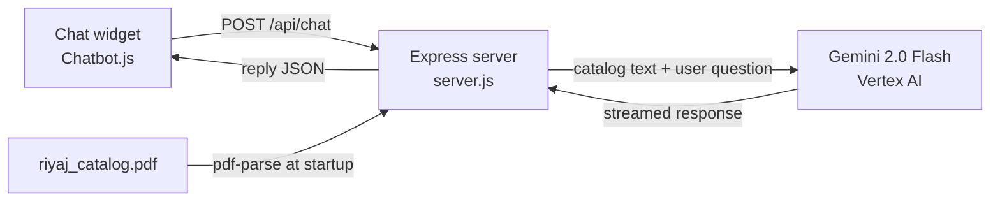

# Chatbot Using Vertex AI

**A customer-support chatbot for an online utensils shop that answers product and price questions from the shop's PDF catalog using Gemini on Google Cloud Vertex AI.**


---

## Overview

Small shops get the same questions again and again: "Do you sell this?", "How much is that?". This project adds a chat assistant to the Riyaj Utensils Shop website that answers those questions using the shop's own product and price catalog.

The backend reads the catalog PDF once at startup, keeps its text in memory, and includes it as context in every prompt sent to Gemini 2.0 Flash on Vertex AI. This grounds the model's answers in the shop's real products instead of general knowledge.

## Key features

- **Catalog-grounded answers** - the shop's catalog (`riyaj_catalog.pdf`) is parsed with `pdf-parse` and passed to the model as context.
- **Gemini on Vertex AI** - uses the `gemini-2.0-flash-001` model through the official `@google-cloud/vertexai` SDK.
- **Simple REST API** - a single `POST /api/chat` endpoint takes a message and returns the reply as JSON.
- **Floating chat widget** - `Chatbot.js` is a drop-in React component (Tailwind-styled) with an open/close button, message history, and Enter-to-send.
- **Locked-down CORS** - the API only accepts requests from the shop's frontend origin.

## How it works



1. On startup, `server.js` reads `riyaj_catalog.pdf` and stores up to 30,000 characters of its text.
2. The chat widget sends the user's message to `POST /api/chat`.
3. The server builds a prompt ("You are a helpful assistant for a utensils shop in Nepal...") with the catalog and the question, and streams the answer from Gemini.
4. The full reply is returned as `{ "reply": "..." }` and shown in the widget.

## Tech stack

| Layer | Tools |
| --- | --- |
| Backend | Node.js, Express, `dotenv`, `cors`, `pdf-parse` |
| AI | Google Cloud Vertex AI, Gemini 2.0 Flash (`@google-cloud/vertexai`) |
| Frontend widget | React (Next.js client component), Tailwind CSS |

## Project structure

```
Chatbot-Using-VertexAI/
├── server.js           # Express API: loads the catalog PDF and calls Vertex AI
├── Chatbot.js          # React chat widget used on the shop website
├── riyaj_catalog.pdf   # Product and price catalog used as model context
└── package.json
```

## Getting started

### Prerequisites

- Node.js 18+
- A Google Cloud project with the Vertex AI API enabled
- Google Cloud credentials available to the app (for example, `gcloud auth application-default login`, or a service-account key referenced by `GOOGLE_APPLICATION_CREDENTIALS`)

### Run the backend

```bash
npm install
npm start
```

The server starts on `http://localhost:5000` by default.

Environment variables (optional `.env` file):

| Name | Purpose |
| --- | --- |
| `PORT` | Port for the Express server (default `5000`) |
| `GOOGLE_APPLICATION_CREDENTIALS` | Path to a Google Cloud service-account key, if not using `gcloud` login |

The Google Cloud project ID, region (`us-central1`), and allowed CORS origin are set at the top of `server.js`; change them to match your own project and frontend.

### Test the API

```bash
curl -X POST http://localhost:5000/api/chat \
  -H "Content-Type: application/json" \
  -d '{"message": "What items do you sell and how much do they cost?"}'
```

Note: CORS only applies to browsers, so `curl` works locally even though the browser origin is restricted.

### Use the chat widget

`Chatbot.js` is written for a Next.js app. Copy it into your components folder and provide a `sendMessageToBot(message)` helper (imported from `app/utils/chatbot`) that posts to `/api/chat` and returns `reply`.

## Future improvements

- Keep conversation history so follow-up questions have context.
- Retrieve only the relevant catalog sections (RAG) instead of sending the whole catalog with every message.
- Move the project ID, region, and CORS origin into environment variables.
- Remove `node_modules/` from version control and add it to `.gitignore`.

## Author

**Riyaj Chaulagain** - Computer Science student at Southeastern Louisiana University

- GitHub: [riyajclgn123](https://github.com/riyajclgn123)
- Portfolio: [riyajchaulagain.com.np](https://riyajchaulagain.com.np)
